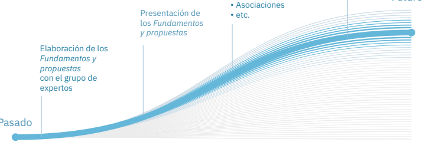
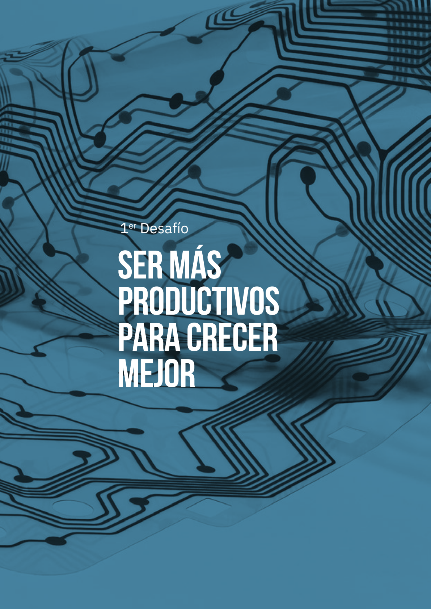

# Fig. 6. Cuadro de indicadores y objetivos

<!-- Table (209, 155, 789, 802) -->
\begin{tabular}{|l|l|l|l|l|l|}
\hline
\multicolumn{2}{|c|}{\textbf{Indicadores}} & \textbf{Promedio 2015-2019 o último dato disponible*} & \multicolumn{3}{c|}{\textbf{Objetivos}} \\
\cline{4-6}
\multicolumn{2}{|c|}{} & & \textbf{2030} & \textbf{2040} & \textbf{2050} \\
\hline
\multicolumn{6}{|l|}{\textbf{Desafío 1: Ser más productivo para crecer mejor}} \\
\hline
1 & Brecha en renta per cápita con la UE-8$^{66}$ & -22\% & -18\% & -15\% & -10\% \\
\hline
2 & Niveles de productividad laboral (euros constantes, PPA 2015)$^{67}$ & 42 & 46 & 53 & 63 \\
\hline
3 & Tasa de empleo$^{68}$ & 62\% & 68\% & 72\% & 80\%$^{69}$ \\
\hline
4 & Gasto total en I+D (\% del PIB)$^{70}$ & 1,2\% & 3,0\%$^{71}$ & 3,5\% & 4,0\% \\
\hline
\multirow{3}{*}{5} & \multirow{3}{*}{\begin{tabular}[c]{@{}l@{}}Empresas por\\ tamaño (según \\ \% de empleo)$^{72}$\end{tabular}} & Grandes (+250 empleados) & 31\%* & 32\% & 33\% & 35\% \\
\cline{3-6}
& & Medianas (20-249) & 23\%* & 25\% & 28\% & 30\% \\
\cline{3-6}
& & Pequeñas (1-19) & 45\%* & 42\% & 38\% & 35\% \\
\hline
6 & Economía sumergida (\% del PIB)$^{73}$ & 20\% & 15\% & 12\% & 10\% \\
\hline
\multicolumn{6}{|l|}{\textbf{Desafío 2: Conquistar la vanguardia educativa}} \\
\hline
7 & Porcentaje del alumnado que ha repetido al menos un curso a los 15 años$^{74}$ & 29\%* & 18\% & 10\% & 5\% \\
\hline
8 & Tasa de abandono escolar temprano$^{75}$ & 17\%* & 10\%$^{76}$ & 6\% & 3\% \\
\hline
9 & Población entre 25 y 34 años con educación superior a la ESO$^{77}$ & 70\%* & 78\% & 86\% & 93\% \\
\hline
10 & Importancia de las diferencias socioeconómicas en la probabilidad de repetición a igualdad de competencias$^{78}$ & 3,9* & 3,0 & 2,0 & 1,0 \\
\hline
\multirow{3}{*}{11} & \multirow{3}{*}{\begin{tabular}[c]{@{}l@{}}Porcentaje del alumnado de 15 \\ años con rendimiento bajo en \\ PISA (inferior al nivel 2)$^{79}$\end{tabular}} & Lectura & 20\% & 18\% & 15\% & <15\% \\
\cline{3-6}
& & Matemáticas & 23\% & 20\% & 18\% & <15\% \\
\cline{3-6}
& & Ciencia & 20\% & 18\% & 15\% & <15\% \\
\hline
\multirow{3}{*}{12} & \multirow{3}{*}{\begin{tabular}[c]{@{}l@{}}Porcentaje del alumnado de 15 \\ años con rendimiento alto en \\ PISA (nivel 5 o superior)$^{80}$\end{tabular}} & Lectura & 5\% & 6\% & 8\% & 10\% \\
\cline{3-6}
& & Matemáticas & 7\% & 10\% & 13\% & 16\% \\
\cline{3-6}
& & Ciencia & 5\% & 6\% & 8\% & 10\% \\
\hline
13 & Gasto público en educación (\% del PIB)$^{81}$ & 4,3\% & 5,1\% & 5,3\% & 5,5\%$^{82}$ \\
\hline
\end{tabular}

# Desafío 3. Mejorar la formación y la recualificación de nuestra población

| Indicadores | Promedio 2015-2019 o último dato disponible* | Objetivos 2030 | 2040 | 2050 |
| :--- | :---: | :---: | :---: | :---: |
| **14** Mujeres estudiantes matriculadas en educación terciaria en ámbito STEM (% del total)⁸³ | 28% | 35% | 42% | 50% |
| **15** Proporción de población adulta (16 a 74 años) que tienen al menos habilidades digitales básicas⁸⁴ | 55% | 70%⁸⁵ | 100% | 100% |
| **16** Población adulta (25-64 años) que reconocen no hablar ninguna lengua extranjera (% del total)⁸⁶ | 46%* | 40% | 30% | 25% |
| **17** Proporción de población adulta (25-64 años) que dice haber participado en algún programa de recualificación en el último año⁸⁷ | 30%* | 50%⁸⁸ | 70% | 90% |
| **18** Proporción de población desempleada (25 a 64 años) con una experiencia de aprendizaje reciente⁸⁹ | 32%* | 35% | 50% | 70% |
| **19** Políticas activas de empleo dedicadas a formación (% del PIB)⁹⁰ | 0,11% | 0,25% | 0,30% | 0,40% |
| **20** Porcentaje de empresas que realizan formación para sus trabajadores por tamaño⁹¹ | Grandes (+250 empleados) 92% | 95% | 100% | 100% |
| | Medianas (50-249) 82% | 88% | 92% | 95% |
| | Pequeñas (10-49) 51% | 60% | 70% | 75% |

# Desafío 4. Convertirnos en una sociedad neutra en carbono, sostenible y resiliente al cambio climático

| | Promedio 2015-2019 o último dato disponible* | Objetivos 2030 | 2040 | 2050 |
| :--- | :---: | :---: | :---: | :---: |
| **21** Emisiones GEI (miles de toneladas de CO₂-eq)⁹² | 330.640 | 223.000⁹³ (-23%) | 126.000 (-57%) | 29.000⁹⁴ (-90%) |
| **22** Demanda de agua (hm³/año)⁹⁵ | 30.983* | 29.434⁹⁶ (-5%) | 27.885 (-10%) | 26.335 (-15%) |
| **23** Intensidad energética primaria (kilogramos equivalentes de petróleo/ miles de euros)⁹⁷ | 115⁹⁸ | 73⁹⁹ (-36%) | 56 (-51%) | 42¹⁰⁰ (-63%) |
| **24** Energía eléctrica generada mediante fuentes renovables (% del total)¹⁰¹ | 36% | -74%¹⁰² | 87% | 100%¹⁰³ |
| **25** Recaudación ambiental (% del PIB)¹⁰⁴ | 1,8% | 2,6% | 4,0% | 5,0%¹⁰⁵ |
| **26** Producción agrícola ecológica (% del total del área cultivada)¹⁰⁶ | 10%* | 25%¹⁰⁷ | 43% | 60% |
| **27** Tasa de reforestación anual (hectáreas/año)¹⁰⁸ | 15.103¹⁰⁹ | 20.000¹¹⁰ | 20.000 | 20.000 |

Introducción  España 2050 45

# Desafío 5. Preparar nuestro estado de bienestar para una sociedad más longeva

<!-- Table (216, 217, 789, 385) -->
\begin{tabular}{llccc}
\hline
Indicadores & Promedio 2015-2019 o último dato disponible* & \multicolumn{3}{c}{Objetivos} \\
\cline{3-5}
& & 2030 & 2040 & 2050 \\
\hline
28 Tasa de actividad$^{111}$ & & & & \\
\quad Entre 55 y 64 años (\%) & 62\%* & 63\% & 64\% & 67\% \\
\quad Entre 65 y 74 años (\%) & 5\%* & 7\% & 9\% & 11\% \\
29 Gasto público en salud (\% PIB) sin incluir el gasto sanitario en cuidados de larga duración$^{112}$ & 5,7\% & 7,0\% & 7,0\% & 7,0\% \\
30 Gasto público en cuidados de larga duración (\% del PIB)$^{113}$ & 0,8\% & 1,5\% & 2,0\% & 2,5\% \\
31 Porcentaje de personas que tienen reconocido el derecho a prestación del SAAD y no la perciben$^{114}$ & 17\%* & 0\% & 0\% & 0\% \\
\hline
\end{tabular}

# Desafío 6. Promover un desarrollo territorial equilibrado, justo y sostenible

<!-- Table (215, 470, 789, 627) -->
\begin{tabular}{llccc}
\hline
Indicadores & Promedio 2015-2019 o último dato disponible* & \multicolumn{3}{c}{Objetivos} \\
\cline{3-5}
& & 2030 & 2040 & 2050 \\
\hline
32 Porcentaje de población que sufre sobrecarga financiera asociada al pago de la vivienda$^{115}$ & 9,5\% & 8,0\% & 6,5\% & 4,5\%$^{116}$ \\
33 Proporción de viviendas rehabilitadas al año (\% del parque total)$^{117}$ & 0,1\% & 1,5\% & 1,8\% & 2,0\% \\
34 Residuos municipales enviados a vertedero (\% del total generado)$^{118}$ & 55\% & 10\%$^{119}$ & 5\% & 0\% \\
35 Población expuesta a niveles de contaminación atmosférica (partículas PM$_{2.5}$) por encima de las recomendaciones de la OMS (\% del total)$^{120}$ & 51\% & 25\% & 15\% & 2\%$^{121}$ \\
36 Pobreza energética (\% de la población que no puede mantener su vivienda a una temperatura adecuada)$^{122}$ & 7,5\%* & 6,0\%$^{123}$ & 3,0\% & 0,0\%$^{124}$ \\
\hline
\end{tabular}

# Desafío 7. Resolver las deficiencias de nuestro mercado de trabajo y adaptarlo a las nuevas realidades sociales, económicas y tecnológicas

<!-- Table (215, 663, 789, 877) -->
\begin{tabular}{llccc}
\hline
Indicadores & Promedio 2015-2019 o último dato disponible* & \multicolumn{3}{c}{Objetivos} \\
\cline{3-5}
& & 2030 & 2040 & 2050 \\
\hline
37 Tasa de desempleo$^{125}$ & 18\% & 12\% & 10\% & 7\% \\
38 Tasa de empleo de las mujeres$^{126}$ & 57\% & 65\% & 75\% & 82\% \\
39 Tasa de desempleo juvenil$^{127}$ & 40\% & 30\% & 21\% & 14\% \\
40 Tasa de empleo (55-64 años)$^{128}$ & 51\% & 56\% & 62\% & 68\% \\
41 Tasa de temporalidad$^{129}$ & 26\% & 23\% & 18\% & 15\% \\
42 Tasa de parcialidad involuntaria$^{130}$ & 9\% & 7\% & 5\% & 3\% \\
43 Horas trabajadas a la semana$^{131}$ & 37,7 & 37,0 & 36,0 & 35,0 \\
44 Brecha salarial de género$^{132}$ & 14\% & 10\% & 5\% & 0\% \\
45 Personas satisfechas con su situación laboral$^{133}$ & 85\%* & 87\% & 90\% & 93\% \\
\hline
\end{tabular}

46 España 2050 ■ Introducción

| Indicadores | Promedio 2015-2019 o último dato disponible* | Objetivos | | |
| :--- | :--- | :--- | :--- | :--- |
| | | 2030 | 2040 | 2050 |

### Desafío 8. Reducir la pobreza y la desigualdad y reactivar el ascensor social

| 46 Índice de Gini (desigualdad de la renta)134 | 34 | 32 | 31 | 29 135 |
| :--- | :--- | :--- | :--- | :--- |
| 47 Población en riesgo de pobreza (% del total) 136 | 22% | 18% | 15% | 10% |
| 48 Recaudación fiscal (% del PIB) 137 | 35% | 37% | 40% | 43% |
| 49 Gasto público en protección social (% del PIB) 138 | 17% | 18% | 19% | 20% |

### Desafío 9. Ampliar las bases de nuestro bienestar futuro

| 50 Porcentaje de personas satisfechas con su vida 139 | 83% | 86% | 89% | 92% |
| :--- | :--- | :--- | :--- | :--- |

Nota: Esta es la versión resumida del cuadro. Para una versión extendida con más detalles véase el anexo 50 objetivos para 2050.

## Solo el primer paso

España 2050 quiere ser un ejercicio de prospectiva estratégica plural e inclusivo que recoja la visión de todos los actores sociales y económicos de nuestro país. Por eso, lo que presentamos aquí no es la Estrategia como tal, sino, como indica el título, una primera propuesta, imperfecta e incompleta, que deberá ser corregida, ampliada y reforzada mediante un diálogo nacional que se pondrá en marcha durante los próximos meses y en el que participarán los Gobiernos autonómicos y las principales instituciones públicas, empresas, sindicatos, universidades, think tanks, asociaciones, fundaciones, organismos del tercer sector y partidos políticos del país [Fig. 7].

Nuestra esperanza es que este diálogo nos permita alcanzar no un consenso (en el que todas las partes acaban pensando lo mismo), pero sí un acuerdo (resultado de concesiones por todas las partes) que dé lugar a la Estrategia Nacional de Largo Plazo como tal. Una Estrategia rigurosa, plural y aterrizada que sirva para sofisticar la visión estratégica de nuestras instituciones públicas y privadas, fortalecer el diseño la segunda fase del plan NextGenerationEU (que abarcará el periodo 2023 - 2026), y orientar la toma de decisiones de los españoles y españolas en las próximas décadas.

Fig. 7. España 2050: Fases del ejercicio

Texto de la figura (OCR)

Pasado
Elaboración de los
Fundamentos y
propuestas
con el grupo de
expertos
Presentación de
los Fundamentos
y propuestas
• Asociaciones
• etc.

Habrá quienes consideren que alcanzar este acuerdo es imposible, especialmente en tiempos tan aparentemente polarizados como el actual. Pero la historia demuestra que nuestro país ya ha logrado mirar al mañana con optimismo antes y ponerse de acuerdo en coyunturas tan o más difíciles que la de ahora. Debemos, por tanto, intentarlo. El bienestar de las generaciones presentes y futuras depende de ello.

---

**48** España 2050 ■ Introducción

# 1er Desafío

## SER MÁS PRODUCTIVOS PARA CRECER MEJOR

Texto de la figura (OCR)

1er Desafío
SER MÁS
PRODUCTIVOS
PARA CRECER
MEJOR

# RESUMEN EJECUTIVO

Desde la llegada de la democracia, España ha experimentado una transformación económica y social muy notable. Nuestra renta per cápita se ha duplicado, nuestra tasa de empleo ha aumentado en más de 15 puntos, y nuestras empresas se han integrado con éxito en el comercio y las redes de financiación internacional. Esto nos ha permitido subirnos al tren del progreso europeo y consolidarnos como una economía moderna, desarrollada y competitiva a escala mundial.

Aun así, nuestro país no ha conseguido reducir sustancialmente la brecha de renta que mantiene con las economías más avanzadas de la UE. La principal causa es la baja productividad, la cual afecta a la práctica totalidad de nuestros sectores económicos. Entre los principales motivos de esta baja productividad, destacan la menor calidad de nuestro capital humano, el déficit en innovación e integración tecnológica de nuestras empresas, y las carencias de nuestro marco regulatorio.

La baja productividad está comprometiendo el desarrollo económico de todo el país y guarda una fuerte relación con los bajos salarios, las largas jornadas laborales o la falta de competitividad de muchas empresas.

El envejecimiento demográfico que tendrá lugar en las próximas décadas podría agravar esta situación. Se estima que, de aquí a mediados de siglo, la población española de entre 16 y 64 años se reducirá en 3,7 millones, situándose por debajo de los 27 millones (niveles de 1996). Sin cambios de calado, esta contracción de la fuerza laboral podría hacer que nuestra economía futura se estanque. Entre 2023 y 2050, el PIB de España podría crecer en un rango de entre el 0,3-1,1% anual, muy lejos del 2% del período 1996-2019, lo que nos alejaría todavía más de los países avanzados de Europa y agravaría problemas como el paro o la desigualdad.

Para evitar este escenario, tendremos que relanzar nuestra productividad y, al mismo tiempo, aumentar nuestra tasa de empleo. Será una tarea ardua, pero no imposible. En los últimos 30 años, países como Finlandia, Suecia, Dinamarca o Alemania han conseguido incrementar su productividad en un 50% sin comprometer la creación de empleo. Si España logra hacer lo mismo, podría crecer a tasas promedio del 1,5% anual y recortar enormemente la brecha en renta per cápita que la separa de los líderes europeos, consolidándose así como una de las economías más prósperas del mundo.

Para conseguirlo, tendremos que hacer una apuesta decidida y contundente por la educación, desde el nacimiento y a lo largo de toda la vida; multiplicar nuestros esfuerzos en I+D; acelerar la digitalización de nuestro tejido productivo; aprovechar las oportunidades de la transición ecológica; reducir al máximo las distorsiones generadas por las trabas administrativas; y atajar la economía sumergida. Solo así podremos crear empleo de calidad, pagar salarios más altos, reducir nuestra vulnerabilidad a las crisis y la competencia exterior, y garantizar el mantenimiento del estado de bienestar sin incurrir en déficits públicos crónicos o hipotecar el bienestar de las generaciones futuras.

---

*Crecer mejor ■ España 2050*

Página 53
